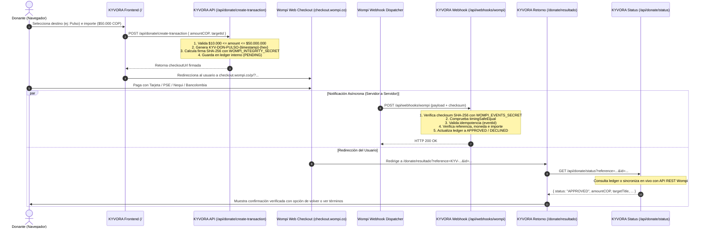

# AUDITORÍA TÉCNICA Y GUÍA DE OPERACIÓN: DONATE US Y WOMPI COLOMBIA
**KYVORA — Laboratorio Tecnológico y Desarrollo de Software**  
**Fecha de Auditoría:** Octubre 2026  
**Entorno Analizado:** Next.js (App Router) en Vercel  
**Estado:** Integración Sandbox Verificada, Endurecida y Lista para Pruebas  

---

## 1. RESUMEN EJECUTIVO Y RESULTADOS DE LA AUDITORÍA

Se ha completado la auditoría integral y el endurecimiento técnico del módulo **Donate Us** y su integración con la pasarela de pagos **Wompi Colombia** (Bancolombia) en el repositorio oficial de KYVORA.

### Hallazgos Clave y Medidas Aplicadas:
1. **Método de Integración:** Se utiliza el **Web Checkout Alojado** oficial de Wompi (`https://checkout.wompi.co/p/`). Este modelo traslada la captura sensible de datos de tarjetas de crédito/débito y credenciales bancarias íntegramente a los servidores PCI-DSS Nivel 1 de Wompi, liberando a la infraestructura de KYVORA de almacenar o procesar datos de pago sensibles.
2. **Eliminación de Claves Hardcodeadas:** Se retiraron todas las cadenas de prueba que figuraban como valores de respaldo en el código. Las credenciales ahora se leen **estrictamente de las variables de entorno**. Si faltan, el servidor aborta la operación con un error explícito en consola y respuesta HTTP 500, impidiendo cobros con credenciales inseguras o incorrectas.
3. **Firma de Integridad Servidor (SHA-256):** Toda solicitud de pago es firmada exclusivamente en el servidor mediante el hash oficial `SHA-256(reference + amount_in_cents + currency + integrity_secret)`. El cliente jamás tiene acceso al secreto de integridad (`WOMPI_INTEGRITY_SECRET`), imposibilitando que un usuario altere el importe o la referencia en el navegador.
4. **Validación Criptográfica de Webhooks:** El webhook `/api/webhooks/wompi` valida la firma `checksum` SHA-256 utilizando `WOMPI_EVENTS_SECRET` y una comparación en tiempo constante (`crypto.timingSafeEqual`) para mitigar ataques de temporización (*timing attacks*).
5. **Idempotencia y Prevención de Replay Attacks:** El sistema almacena los IDs de eventos procesados (`processedEventIds`). Eventos duplicados o reintentados por la red de Wompi devuelven HTTP 200 de forma idempotente sin duplicar registros contables ni mutaciones.
6. **Resiliencia ante Arranque Frío en Vercel:** Dado que las funciones Serverless de Vercel son efímeras y no comparten memoria entre instancias distribuidas, `/api/donate/status` y `/api/webhooks/wompi` implementan sincronización directa y reconstrucción mediante consulta al API REST de Wompi (`https://sandbox.wompi.co/v1/transactions/:id`).
7. **Página de Retorno Segura (`/donate/resultado`):** La pantalla de agradecimiento y confirmación jamás confía en los parámetros de la URL aportados por el navegador (`?status=...`). En su lugar, consume `/api/donate/status`, el cual consulta el ledger autenticado del servidor o el API oficial de Wompi antes de mostrar el comprobante.
8. **Referencias Semánticas y Trazabilidad:** Las referencias ahora incorporan el código del proyecto destino (`KYV-DON-PULSO-...`, `KYV-DON-QUAKE-...`, `KYV-DON-PULSAI-...`, `KYV-DON-GEN-...`), facilitando la reconciliación visual inmediata en el panel de Wompi.

---

## 2. ARQUITECTURA DEL FLUJO DE PAGO Y AUDITORÍA



---

## 3. INVENTARIO DE VARIABLES DE ENTORNO

> [!CAUTION]
> **REGLA ABSOLUTA DE SEGURIDAD:**
> Las claves `WOMPI_INTEGRITY_SECRET` y `WOMPI_EVENTS_SECRET` **NUNCA** deben tener el prefijo `NEXT_PUBLIC_`. Si se les asigna dicho prefijo, Next.js las compilará en el JavaScript público que cualquier usuario puede leer desde el navegador, comprometiendo la seguridad de la cuenta.

| Variable | Visibilidad | Propósito | Formato Sandbox | Formato Producción |
| :--- | :--- | :--- | :--- | :--- |
| `NEXT_PUBLIC_SITE_URL` | Pública (Browser & Node) | URL base para canonical y URLs de redirección de retorno | `http://localhost:3000` | `https://www.kyvora.net.co` |
| `NEXT_PUBLIC_WOMPI_ENVIRONMENT` | Pública (Browser & Node) | Determina el ambiente de la pasarela (`sandbox` o `production`) | `sandbox` | `production` |
| `NEXT_PUBLIC_WOMPI_PUBLIC_KEY` | Pública (Browser & Node) | Identificador de comercio en Wompi para inicializar el checkout | `pub_test_...` | `pub_prod_...` |
| `WOMPI_INTEGRITY_SECRET` | **Privada (Solo Servidor)** | Secreto para calcular la firma SHA-256 de integridad | `test_integrity_...` | `prod_integrity_...` |
| `WOMPI_EVENTS_SECRET` | **Privada (Solo Servidor)** | Secreto para verificar la autenticidad criptográfica del webhook | `test_events_...` | `prod_events_...` |
| `RESEND_API_KEY` | **Privada (Solo Servidor)** | Envío de notificaciones transaccionales y contacto | `re_...` | `re_...` |
| `CONTACT_NOTIFICATION_EMAIL` | **Privada (Solo Servidor)** | Correo receptor de PQRS y contactos | `kyvorasas@gmail.com` | `kyvorasas@gmail.com` |

---

## 4. CHECKLIST DE CONFIGURACIÓN POR AMBIENTE EN VERCEL

### A. Entorno Local (`.env.local`)
1. Crear el archivo `.env.local` en la raíz del proyecto (este archivo está excluido en `.gitignore`).
2. Configurar las variables con las llaves de **Sandbox**:
   ```bash
   NEXT_PUBLIC_SITE_URL=http://localhost:3000
   NEXT_PUBLIC_WOMPI_ENVIRONMENT=sandbox
   NEXT_PUBLIC_WOMPI_PUBLIC_KEY=pub_test_TU_LLAVE_DE_SANDBOX
   WOMPI_INTEGRITY_SECRET=test_integrity_TU_SECRETO_DE_INTEGRIDAD
   WOMPI_EVENTS_SECRET=test_events_TU_SECRETO_DE_EVENTOS
   RESEND_API_KEY=re_TU_API_KEY
   CONTACT_NOTIFICATION_EMAIL=kyvorasas@gmail.com
   ```

### B. Entorno Preview en Vercel (Ramas y Pull Requests)
1. Ir al panel de **Vercel** > Proyecto `web-kyvora` > **Settings** > **Environment Variables**.
2. Añadir las mismas variables de Sandbox seleccionando los entornos **Preview** y **Development**.
3. En `NEXT_PUBLIC_SITE_URL`, dejar vacío o usar la variable automática del sistema para previews si se requiere retorno relativo.

### C. Entorno Producción en Vercel (`main` / `production`)
> [!IMPORTANT]
> **NO ACTIVAR PRODUCCIÓN HASTA FINALIZAR LAS PRUEBAS EN SANDBOX.**
> Cuando el comercio de KYVORA esté aprobado y activo en Wompi:
1. En el panel de **Wompi** (Comercio Real):
   - Copiar la **Llave Pública de Producción** (`pub_prod_...`).
   - Copiar el **Secreto de Integridad de Producción** (`prod_integrity_...`).
   - Copiar el **Secreto de Eventos de Producción** (`prod_events_...`).
   - Configurar la **URL de Eventos (Webhook)** en Wompi:
     `https://www.kyvora.net.co/api/webhooks/wompi`
2. En el panel de **Vercel** > **Environment Variables** (Scope: **Production**):
   - `NEXT_PUBLIC_SITE_URL` = `https://www.kyvora.net.co`
   - `NEXT_PUBLIC_WOMPI_ENVIRONMENT` = `production`
   - `NEXT_PUBLIC_WOMPI_PUBLIC_KEY` = `pub_prod_...`
   - `WOMPI_INTEGRITY_SECRET` = `prod_integrity_...`
   - `WOMPI_EVENTS_SECRET` = `prod_events_...`
3. Realizar un nuevo despliegue en Vercel para inyectar las nuevas variables en el bundle de producción.

---

## 5. GUÍA DE PRUEBAS EN SANDBOX DE WOMPI

Wompi proporciona datos simulados para evaluar todos los flujos sin mover dinero real:

### Tarjetas de Crédito de Prueba (Sandbox)
* **Fecha de vencimiento:** Cualquier fecha futura (ej: `12/30`).
* **CVV:** Cualquier número de 3 dígitos (ej: `123`).
* **Nombre:** Cualquier texto (ej: `Aportante de Prueba`).

| Caso de Prueba | Número de Tarjeta | Resultado Esperado |
| :--- | :--- | :--- |
| **Aprobación Exitosa** | `4242 4242 4242 4242` | Estado `APPROVED`, redirección a pantalla verde de agradecimiento |
| **Fondos Insuficientes** | `4000 0000 0000 0002` | Estado `DECLINED`, pantalla roja informando rechazo bancario |
| **Tarjeta Vencida / Rechazada** | `4000 0000 0000 0003` | Estado `DECLINED`, opción de reintentar con otro medio |
| **Error de Procesamiento** | `4000 0000 0000 0004` | Estado `ERROR`, registro de alerta en auditoría |
| **Autenticación 3D Secure (3DS)** | `4000 0000 0000 0005` | Despliega ventana modal de autenticación bancaria de prueba |

### Pruebas de PSE en Sandbox
* Seleccionar cualquier banco ficticio disponible en el selector de Wompi Sandbox.
* En el formulario de PSE, ingresar cualquier correo y número de cédula.
* Wompi Sandbox presentará una interfaz para forzar la transacción como:
  * **Aprobar:** Sincroniza `APPROVED`.
  * **Rechazar:** Sincroniza `DECLINED`.
  * **Dejar Pendiente:** Sincroniza `PENDING` (prueba ideal para validar el botón "Actualizar estado" en `/donate/resultado`).

### Simulación de Webhooks Localmente
Para probar webhooks en tu máquina local sin exponer puertos públicos:
```bash
# Ejecutar suite de validación criptográfica y lógica de negocio
node scripts/test-wompi-and-security.js
```
Para recibir eventos reales de Wompi Sandbox en local, puedes usar un túnel seguro como ngrok o cloudflared:
```bash
npx localtunnel --port 3000
# Configurar la URL temporal generada en el panel Sandbox de Wompi:
# https://tu-subdominio.loca.lt/api/webhooks/wompi
```

---

## 6. MATRIZ DE SEGURIDAD Y COMPATIBILIDAD LEGAL

| Dimensión | Requisito Legal / Técnico | Implementación en KYVORA |
| :--- | :--- | :--- |
| **Estatuto del Consumidor (Ley 1480 de 2011)** | Información clara de precios, moneda y límites operativos | Importe explícito en Pesos Colombianos (COP), validación de mínimos ($10.000) y máximos ($50.000.000). |
| **Decreto 587 de 2016** | Política clara sobre reversiones de pagos en comercio electrónico | Vinculación explícita a `/legal/pagos-reversiones` en el pie de página y en el módulo de aportes. |
| **Régimen Tributario Colombiano** | Claridad sobre deducibilidad de donaciones | Advertencia visible en Donate Us: los aportes son a persona natural y **no constituyen donaciones a ESAL deducibles de renta**. |
| **Protección de Datos (Ley 1581 de 2012)** | Autorización previa y política de tratamiento de datos personales | Aviso de privacidad y enlace a `/legal/datos-personales` en todos los formularios. |
| **PCI-DSS Compliance** | No almacenar datos de tarjetas de crédito o débito | Delegación total al Web Checkout de Wompi mediante redirección firmada con SHA-256. |
| **Integridad Transaccional** | Evitar ataques man-in-the-middle y modificación de importes | Firma criptográfica SHA-256 calculada exclusivamente en el servidor con secreto privado. |
| **Mitigación de Timing Attacks** | Comparación de firmas y checksums segura frente a análisis de tiempos | Empleo de `crypto.timingSafeEqual` en lugar del operador de igualdad estándar (`===`). |

---

## 7. SUITE DE PRUEBAS AUTOMATIZADAS

El repositorio cuenta con una suite completa de pruebas unitarias y de integración que verifica 21 condiciones críticas de seguridad:
* **Firma de Integridad:** Algoritmo oficial SHA-256 de 64 caracteres y resistencia a manipulación de importes.
* **Checksum de Webhook:** Validación estricta con propiedades anidadas y rechazo ante firmas adulteradas o claves espurias.
* **Idempotencia:** Supresión de efectos en notificaciones duplicadas (ataques replay o reintentos de red).
* **Control de Moneda e Importes:** Detección inmediata de inconsistencias monetarias.
* **Límites Financieros:** Bloqueo de importes inferiores a $10.000 COP o superiores a $50.000.000 COP.
* **Nomenclatura Semántica:** Generación de referencias con identificadores de proyecto (`KYV-DON-PULSO-...`, etc.).
* **Mapeo Canónico:** Transición uniforme de estados (`APPROVED`, `DECLINED`, `VOIDED`, `ERROR`, `PENDING`).

Para ejecutar la suite en cualquier momento:
```bash
npm test
# o alternativamente:
node scripts/test-wompi-and-security.js
```
Resultado actual: **21 pruebas aprobadas, 0 fallos.**
